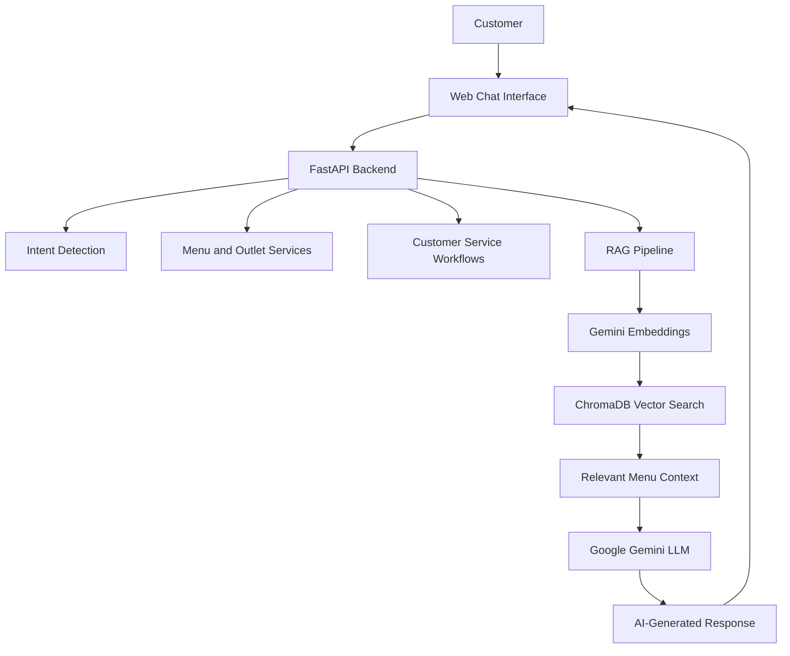

# 🍩 Dunkin’ KSA AI Chatbot

**An AI-powered customer service assistant for Dunkin’ Saudi Arabia (KSA), built with Google Gemini, FastAPI, ChromaDB, and Retrieval-Augmented Generation (RAG).**

The Dunkin’ KSA AI Chatbot helps customers explore menu items, discover products, search by price and category, access outlet information, and navigate customer-service workflows through an interactive conversational interface.

## ✨ Key Features

- 🤖 **AI-Powered Conversations** — Natural-language interactions powered by Google Gemini.
- 🍩 **Smart Menu Discovery** — Explore donuts and other menu products.
- 🔍 **Semantic Search** — Find relevant menu items using embedding-based retrieval.
- 🧠 **RAG Architecture** — Retrieve relevant menu information to support context-aware responses.
- 💰 **Price-Based Search** — Discover products based on pricing criteria.
- 📂 **Category-Based Browsing** — Explore products by menu category.
- 📍 **Outlet Information** — Access Dunkin’ KSA store locator information.
- 📝 **Customer Complaint Workflow** — Guide customers through complaint submission.
- 🔢 **Billing Number Collection** — Support billing-related customer-service workflows.
- 💬 **Session-Based Conversations** — Maintain conversation state across interactions.
- 🌙 **Responsive Interface Experience** — Light and dark modes.
- 🌐 **English-Language Interface** — Designed for English-language customer interactions.
- 🐳 **Docker Support** — Containerization support for deployment and development.

## 🛠️ Technology Stack

| Component | Technologies |
|---|---|
| Frontend | HTML, CSS, JavaScript |
| Backend | Python, FastAPI, Uvicorn, Pydantic |
| Large Language Model | Google Gemini |
| Embeddings | Gemini Embedding API |
| Vector Database | ChromaDB |
| AI Architecture | Retrieval-Augmented Generation (RAG) |
| Utilities | Playwright, JSON, python-dotenv |
| Containerization | Docker, Docker Compose |

## 🏗️ System Architecture



## ⚙️ How It Works

1. **User Input:** The customer submits a question through the chatbot interface.
2. **Request Processing:** The FastAPI backend processes the request and routes it to the relevant service.
3. **Semantic Retrieval:** For supported knowledge-based queries, the RAG pipeline uses embeddings and ChromaDB to retrieve relevant menu information.
4. **Contextual Response Generation:** Retrieved information is provided to the Gemini model to generate a relevant response.
5. **Customer Interaction:** The response is displayed in the chat interface, while supported workflows handle tasks such as complaint submission and billing-number collection.

## 🚀 Getting Started

### Prerequisites

- Python 3.10 or a version compatible with the project's dependencies
- A Google Gemini API key
- Docker and Docker Compose, if using the containerized setup

### Installation

1. Clone the repository:

   ```bash
   git clone https://github.com/Shanas7/KSA-DUNKIN_DONUT-Chatbot.git
   cd KSA-DUNKIN_DONUT-Chatbot
   ```

2. Navigate to the application directory if the chatbot source code is inside `my-ai-chatbot`:

   ```bash
   cd my-ai-chatbot
   ```

3. Create and activate a virtual environment:

   ```bash
   python -m venv .venv
   ```

   Windows:

   ```bash
   .venv\Scripts\activate
   ```

4. Install the project's dependencies using its available dependency file:

   ```bash
   pip install -r requirements.txt
   ```

5. Configure the required environment variables using a local `.env` file, following the variable names expected by the application. Never commit API keys or credentials.

6. Start the application using the project's actual entry point and run configuration.

> **Note:** Verify the dependency file, environment variable names, and backend entry point against the source code before following these commands. Update this section with the exact startup command and frontend instructions.

## 🔐 Configuration and Security

- Store API keys and other credentials in environment variables.
- Keep `.env` files and private credentials out of version control.
- Use a `.env.example` file to document the required configuration without exposing secrets.
- Do not include customer data or confidential business information in the public repository.

## 🎯 Project Objectives

- Make menu discovery easier through natural-language queries.
- Use semantic retrieval to connect customer questions with relevant product information.
- Combine LLM-based response generation with a structured backend.
- Support common customer-service interactions through dedicated workflows.
- Demonstrate the practical application of Generative AI and RAG in a customer-facing chatbot.

## 🧑‍💻 Technologies Demonstrated

Python · Generative AI · Google Gemini · Large Language Models · Retrieval-Augmented Generation · Vector Databases · ChromaDB · FastAPI · REST APIs · Embeddings · Docker

## 👨‍💻 Author

**Shanas7**

GitHub: [@Shanas7](https://github.com/Shanas7)

---

*This project demonstrates an AI-powered customer-service chatbot architecture. It is not an official Dunkin’ product unless formally authorized by the brand.*

